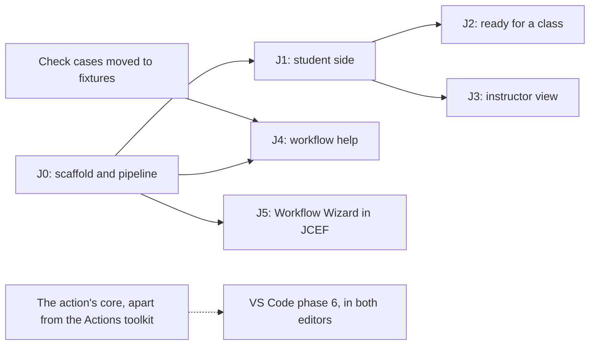

# JetBrains plugin — plan

> **Recorded:** 2026-10-19 (`d1f974c`), against VS Code extension 0.4.4.
> **Updated:** 2026-10-23, 0.2.0 released with J1 to J3; J4 and J5 built on `j4`.
> **Status:** J0 done. 0.2.0, with J1, J2 and J3, is on the Marketplace's
> default channel since 2026-10-23. Their hand checks were not done before it
> shipped: see [J1 progress](#j1-progress), [J2 progress](#j2-progress) and
> [J3 progress](#j3-progress). J4 and J5 built, together on `j4`: see
> [J4 progress](#j4-progress) and [J5 progress](#j5-progress).

A JetBrains plugin that does what GrillMyCode Companion does in VS Code: the
questions the action posts, shown beside the code they ask about. It lives in
`extensions/jetbrains/` and releases on its own `jetbrains-v*` tags.

Elsewhere: the VS Code extension's plan, which this follows, in
`vscode-extension-plan.md`, and the rules for contributors in `AGENTS.md`.

---

## Phases at a glance

| Phase | What it adds                                                                                                                                                                    | Needs first                    | Status      |
| ----- | ------------------------------------------------------------------------------------------------------------------------------------------------------------------------------- | ------------------------------ | ----------- |
| J0    | Scaffold and pipeline: Gradle IntelliJ Platform Plugin 2.x, Kotlin, ktlint, Plugin Verifier, a CI job on JDK 21, a `jetbrains-v*` release workflow, signing, a devcontainer JDK | Nothing                        | Done        |
| J1    | Student side: sign-in, the questions list, the selected question, the jump to code, the moved-code warning, next and previous, several files, the new-questions notice          | J0                             | In progress |
| J2    | Ready for a class: the Marketplace listing, a reference page and a line in the student guide, a stable release, hand checks on Windows and macOS                                | J1                             | In progress |
| J3    | Instructor view: the answer key beside the student's code, and the view switch                                                                                                  | J1                             | In progress |
| J4    | Workflow help: the action's inputs checked, offered and described in a workflow file                                                                                            | J0, and the shared check cases | Built       |
| J5    | The docs site's Workflow Wizard in a JCEF tab, reading the open project and writing the workflow file                                                                           | J0                             | Built       |

Keep this table current when a phase starts, finishes or changes scope. The
suggested order is J0, J1, J2, then J3 to J5 in any order. VS Code's phase 6
(preview and trial runs) comes to both editors later, from the same extracted
core.

| Phase | Done when                                                                                                                                                     |
| ----- | ------------------------------------------------------------------------------------------------------------------------------------------------------------- |
| J0    | An empty plugin builds, passes the verifier, and the release workflow is ready to sign and publish it                                                         |
| J1    | The fixture tests pass in Kotlin, a student sees their questions in IntelliJ IDEA, PyCharm and WebStorm, and the plugin is on the Marketplace's `eap` channel |
| J2    | A student follows the guide from install to their questions without help                                                                                      |
| J3    | The VS Code phase 3 rules hold, checked against `fixtures/*/with-answers/`, and a student account sees no sign of the instructor view                         |
| J4    | It passes the shared check cases, and sits beside JetBrains' own GitHub Actions support without reporting a problem twice                                     |
| J5    | All ten steps work, dark and light. Where JCEF is missing, the plugin opens the Wizard on the docs site instead                                               |

### J1 progress

| Piece                                                                                                   | Where                                                                                                      | Status                                          |
| ------------------------------------------------------------------------------------------------------- | ---------------------------------------------------------------------------------------------------------- | ----------------------------------------------- |
| Report reader and issue picker, ported with their tests                                                 | `shared/Report.kt`, `shared/Issues.kt`                                                                     | Done, passes every fixture                      |
| GitHub sign-in and sign-out, Tools > GrillMyCode                                                        | `auth/`                                                                                                    | Done, tried against GitHub                      |
| Owner and repository from the Git remote, the issues listed, the question model                         | `shared/Remote.kt`, `shared/GitHub.kt`, `shared/Questions.kt`                                              | Done, with the VS Code tests                    |
| Tool window: the questions list, a message for each state, open a question's code                       | `questions/`, with the bundled Git plugin (`Git4Idea`)                                                     | Done, tried by hand                             |
| First Marketplace upload, by hand, to the `eap` channel                                                 | plugins.jetbrains.com                                                                                      | Approved 2026-10-22                             |
| Selected question: a details panel below the tree                                                       | `shared/Html.kt`, a port of `html.js`, in a Swing HTML pane                                                | Done, tried by hand                             |
| Highlights on the question's lines in the editor                                                        | `questions/Highlighter.kt`, `MarkupModel` range highlighters                                               | Done, tried by hand                             |
| Moved-code warning, and the note on a report too long to show in full                                   | `describeDrift`, with changed files from `ChangeListManager` and unsaved documents (`questions/Folder.kt`) | Done, tried by hand                             |
| Next and previous question                                                                              | Actions on `adjacentQuestion`, in the tool window's title and Tools > GrillMyCode                          | Done, tried by hand                             |
| Question text wrapped in the list, each row as tall as its text. VS Code cannot: its plan sets it aside | A tree cell renderer that wraps to the tree's width, rows of variable height                               | Done, tried by hand                             |
| Choosing among several questions issues, remembered by title                                            | `chooseIssue`'s `preferredTitle`, in `PropertiesComponent`; a popup from the tool window's title           | Done, tried by hand                             |
| New-questions notice: a check every minute while the IDE has the focus, a balloon and a badge           | `whatArrived`, `BadgeIconSupplier`; starts when the tool window first opens                                | Done, tried by hand                             |
| The untrusted-project message                                                                           | `TrustedProjects.isProjectTrusted`, when no repository is found                                            | Done, tried by hand                             |
| A message of its own when the repository's organization has not approved the app                        | `auth/AppApproval.kt`, the `NotApproved` state                                                             | Built; GitHub's answer not yet checked (see J2) |
| Hand checks in PyCharm and WebStorm, then J1 is done                                                    |                                                                                                            | To do                                           |

The first upload, 0.1.0-eap.1, was approved on 2026-10-22 and landed on the
default channel, not `eap`, so 0.1.0-eap.2 was skipped and its changes shipped
in 0.2.0. Its listing stayed hidden from search until 0.2.0 was published. The
listing is <https://plugins.jetbrains.com/plugin/35347-grillmycode-companion>.

### J2 progress

GitHub turns on OAuth app access restrictions for every new organization, and
a classroom organization is usually new. Until an owner approves "GrillMyCode
Companion", the plugin cannot read a student's repository. That makes the
approval a setup step for every instructor.

| Piece                                                                                                                 | Where                                                    | Status                                                                                                                                                                                                               |
| --------------------------------------------------------------------------------------------------------------------- | -------------------------------------------------------- | -------------------------------------------------------------------------------------------------------------------------------------------------------------------------------------------------------------------- |
| Instructor guide, with approving the app as its setup step                                                            | `docs-site/docs/guides/jetbrains-plugin.md`              | Drafted, with its **Go deeper** line. Merge with the stable release, not before: it tells students to install from the Marketplace's default channel                                                                 |
| Student guide                                                                                                         | `docs-site/docs/guides/jetbrains-plugin-students.md`     | Drafted. Its UI text is checked against the code; the IDE's own labels (the privacy note, safe mode's bar) are described, not quoted                                                                                 |
| Reference page                                                                                                        | `docs-site/docs/reference/jetbrains-plugin.md`           | Drafted, with the Marketplace link                                                                                                                                                                                   |
| A line in `what-students-see.md`, the FAQ, `how-gmc-works.md`, `README.md`, `assessment-output.md` and the slide deck |                                                          | Done. The README's and the listing's grillmycode.org links 404 until an action tag snapshots the docs                                                                                                                |
| Marketplace description                                                                                               | `plugin.xml`                                             | Done, written for the stable release                                                                                                                                                                                 |
| Screenshots                                                                                                           | `jetbrains-plugin-questions.png`, plugins.jetbrains.com  | In both guides. Upload the same shot to the listing by hand                                                                                                                                                          |
| What GitHub answers a token whose app the organization has not approved                                               | A test organization, `check-org-approval.sh` run by hand | To do. The code expects 403 and the words "OAuth App access restrictions"; `AppApprovalTest` holds a body written from memory, to replace with the real one                                                          |
| The buttons GitHub shows: an owner's to approve ("Grant"?), a member's to ask ("Request"?)                            | The same test organization                               | To do. The instructor guide says **Grant**; the student guide avoids naming the member's button                                                                                                                      |
| Whether the VS Code extension meets the same restriction, through VS Code's own GitHub app                            | The same test organization, in VS Code                   | To do. If it does, its guide gets the step too                                                                                                                                                                       |
| A required plugin in the template (`.idea/externalDependencies.xml`), so the IDE offers to install it                 | The instructor guide                                     | To try once 0.2.0 is on the default channel. Open a folder holding only that `.idea/` file in IDEA, PyCharm and WebStorm: does the IDE offer the plugin, and does it still set the project up as for a plain folder? |
| Hand checks on Windows and macOS                                                                                      |                                                          | To do                                                                                                                                                                                                                |
| Stable release, `0.2.0` on the default channel                                                                        | `jetbrains-v*` tag                                       | Released 2026-10-23, with J3, before the hand checks. The verifier found two deprecated calls in 2026.3 EAP: fixed on `j4`                                                                                           |

### J3 progress

Shipped in 0.2.0 with J2, decided on 2026-10-23: no one was on the `eap`
channel, so a release between them would have reached no one.

| Piece                                                                                                 | Where                                                                         | Status                                                                     |
| ----------------------------------------------------------------------------------------------------- | ----------------------------------------------------------------------------- | -------------------------------------------------------------------------- |
| Submission identity, ported with its tests                                                            | `shared/Identity.kt`                                                          | Done                                                                       |
| The two requests: direct collaborators, one file                                                      | `shared/GitHub.kt`                                                            | Done, with the VS Code tests                                               |
| Answer key reader and finder, the answer's markup                                                     | `instructor/AnswerKey.kt`, `instructor/Html.kt`, imports nothing from the IDE | Done, passes every `current/` fixture's `questions.json`                   |
| The key looked for on each load; the view chosen, remembered per repository, switched with no request | `QuestionsService`: `key`, `view`, `present`, `switchView`                    | Built                                                                      |
| The tree, the answer below it, the view's name in the title, the different-runs note                  | `QuestionsPanel`, `QuestionDetails.toHtml`                                    | Built                                                                      |
| **Show Instructor View** and **Show Student View**, visible only with a key                           | `SwitchViewAction`, in the title bar and Tools > GrillMyCode                  | Built                                                                      |
| Reference section, a guide paragraph, the listing's line                                              | `reference/jetbrains-plugin.md`, `guides/jetbrains-plugin.md`, `plugin.xml`   | Drafted. The reference links to VS Code's section for the shared rules     |
| Hand check as an instructor: someone else's repository, then a test repository of one's own           | A classroom organization with an instructor repository                        | To do. Also shows the two buttons and the view's name in the title         |
| Hand check as a student: no answers, no buttons, nothing under Find Action or Tools                   | The same, with a student account                                              | To do. Find Action hides an action that is not visible: check it does here |

### J4 progress

On the `j4` branch, cut from main after 0.2.0.

| Piece                                                                                   | Where                                                                               | Status                                                                                                                  |
| --------------------------------------------------------------------------------------- | ----------------------------------------------------------------------------------- | ----------------------------------------------------------------------------------------------------------------------- |
| The action's inputs as JSON, from the same generator                                    | `scripts/build-extension-action-inputs.js`, `src/main/resources/action-inputs.json` | Done, checked by `test/extension-action-inputs.test.js`                                                                 |
| The workflow help's cases moved to fixtures, read by both editors                       | `extensions/fixtures/workflow-help/`, the three VS Code tests                       | Done                                                                                                                    |
| Reading a workflow, with offsets, as the `yaml` package does                            | `shared/Workflow.kt`, SnakeYAML Engine 2.9 bundled                                  | Done. Reads past a mistake by blanking its line, where the `yaml` package recovers on its own                           |
| Checks, completion, descriptions, ported with the same messages                         | `shared/InputChecks.kt`, `shared/WorkflowHelp.kt`, `shared/JavaScript.kt`           | Done, passes every case and every workflow in the docs                                                                  |
| The inspection, completion and Quick Documentation                                      | `workflow/`, in `grillmycode-yaml.xml`, an optional dependency on the YAML plugin   | Built, with light-IDE tests (`WorkflowHelpIdeTest`)                                                                     |
| The switch: the inspection, which completion and descriptions follow                    | `workflowHelpOn`                                                                    | Built                                                                                                                   |
| Reference section, a guide line, the listing's line, CHANGELOG                          | `reference/jetbrains-plugin.md`, `guides/jetbrains-plugin.md`, `plugin.xml`         | Drafted. The reference links to VS Code's section for the rules both share                                              |
| Hand check in IntelliJ IDEA Community and PyCharm: marks, completion as you type, hover | A workflow file                                                                     | To do. Completion opening by itself as you type is not covered by the light tests                                       |
| Hand check in IntelliJ IDEA Ultimate, beside JetBrains' GitHub Actions support          | The same                                                                            | To do. Its "undefined parameters" check may report an unknown input twice; if it does, leave unknown inputs to it there |

### J5 progress

On `j4` too: the Wizard's tab needed nothing from J4, but both reach the
editor's parity with VS Code in one release.

| Piece                                                                                             | Where                                                                                                                        | Status                                                                                                                                                  |
| ------------------------------------------------------------------------------------------------- | ---------------------------------------------------------------------------------------------------------------------------- | ------------------------------------------------------------------------------------------------------------------------------------------------------- |
| The Wizard's bundle, built by VS Code's `esbuild.js --wizard-out=` and carried as resources       | `buildWizard` in `build.gradle.kts`; Node and `pnpm install` in `extensions/vscode/`, in every CI job that builds the plugin | Done                                                                                                                                                    |
| The page: its policy, the bundle written in, the bridge, the IDE's colours as VS Code's variables | `shared/Wizard.kt`, `wizard-bridge.js`, `wizard/WizardTheme.kt`                                                              | Done, with `WizardTest` and a bridge test in `test/extension-wizard.test.js`                                                                            |
| What the page may ask: the folder, its listings, a file's start, the workflow file                | `wizard/WizardHost.kt`, a port of VS Code's rules                                                                            | Done, with `WizardHostTest` in a light IDE                                                                                                              |
| The tab, its action, the theme followed, links in the browser                                     | `wizard/WizardEditor.kt`, **Tools \| GrillMyCode \| Open Workflow Wizard**                                                   | Built. A test IDE has no JCEF, so the page has not run yet                                                                                              |
| The fallback without JCEF: the Wizard on the docs site                                            | `OpenWorkflowWizardAction`                                                                                                   | Built                                                                                                                                                   |
| Reference section, a guide paragraph, the listing's line, CHANGELOG                               | `reference/jetbrains-plugin.md`, `guides/jetbrains-plugin.md`, `plugin.xml`                                                  | Drafted. The reference links to VS Code's for what the tab reads                                                                                        |
| Hand check: all ten steps, dark and light, in IntelliJ IDEA and PyCharm                           | A project with a template's files                                                                                            | To do. Also: the folder preview, **Create the workflow file** with and without one there, the model list from OpenRouter, a link opening in the browser |
| Hand check on Windows and macOS                                                                   | The same                                                                                                                     | To do                                                                                                                                                   |

---

## The approach: Kotlin, with the contracts shared

A JetBrains plugin runs on the JVM, so `extensions/vscode/src/shared/` cannot
be loaded as it is.

| Option                                         | Verdict                                                                                    |
| ---------------------------------------------- | ------------------------------------------------------------------------------------------ |
| A Kotlin port of `shared/`, tested on fixtures | **Chosen.** Idiomatic, works in every IDE, and the fixtures keep the two readers in step   |
| The JavaScript run in GraalJS                  | A large runtime, hard to debug, and unusual for a Marketplace review                       |
| The JavaScript run on Node                     | Only some IDEs ship Node. Students on PyCharm or IntelliJ IDEA Community would be left out |

Each feature then exists twice. What keeps the two from drifting is test data
both editors read, in a form neither language owns:

| Contract                              | Shared today                              | Needed for JetBrains                                    |
| ------------------------------------- | ----------------------------------------- | ------------------------------------------------------- |
| Report and answer-key layout          | `extensions/fixtures/`, JSON and Markdown | A Kotlin test that reads the same folders               |
| The action's inputs                   | `action-inputs.js`, generated             | The same generator also writes `action-inputs.json`     |
| Input checks                          | Cases inside `test/input-checks.test.js`  | The cases moved to fixtures, so both suites run them    |
| Code matching, the moved-code warning | Cases inside the JavaScript tests         | The same                                                |
| Workflow Wizard                       | `docs-site/docs/_workflow-wizard/`        | Bundled where it stands and shown in JCEF. Never ported |

---

## How the pieces map

| VS Code                                                                     | JetBrains                                                                                                                    |
| --------------------------------------------------------------------------- | ---------------------------------------------------------------------------------------------------------------------------- |
| Activity bar view: Questions and Selected Question                          | A tool window: a tree above a details panel                                                                                  |
| Selected Question webview, which runs no script                             | A Swing HTML pane (`JEditorPane`) with issue text escaped. No JCEF, so the one page that runs a script stays the Wizard's    |
| Highlight and jump to code, closing the tabs opened for the question before | `MarkupModel` range highlighters and `OpenFileDescriptor`. The tabs opened for the question before close, by VS Code's rules |
| VS Code's built-in Git extension                                            | The bundled Git plugin (`Git4Idea`), for remotes and HEAD                                                                    |
| Restricted Mode                                                             | `TrustedProjects`, with the same message for a project that is not trusted                                                   |
| `vscode.authentication`, the `repo` scope                                   | Our own GitHub device flow (`auth/`), the token in `PasswordSafe`. See [Decisions](#decisions)                               |
| Welcome views, one per state (`signedOut`, `noIssue`, `needsUpdate`…)       | An empty-state panel in the tool window, in the same words                                                                   |
| The new-questions notice                                                    | A notification balloon and a badge on the tool window's icon                                                                 |
| Workflow help                                                               | An inspection, a completion contributor and a documentation provider for YAML files, working on the text as VS Code does     |
| The Workflow Wizard's tab                                                   | `JBCefBrowser`, VS Code's bundle written into the page, and a `JBCefJSQuery` bridge that stands in for `acquireVsCodeApi`    |
| The walkthrough                                                             | A short "Get started" panel the first time the tool window opens                                                             |

The VS Code [rules that outlast the phases](vscode-extension-plan.md#rules-that-outlast-the-phases)
apply here too. In particular: the report format, not the version number, ties
the plugin to the action; an unknown input is a warning, never an error; there
is one Workflow Wizard; and a student's copy shows no sign of the instructor
view.

---

## Changes outside `extensions/jetbrains/`

| Where                                      | Change                                                                                                                   | Status                                      |
| ------------------------------------------ | ------------------------------------------------------------------------------------------------------------------------ | ------------------------------------------- |
| `AGENTS.md`                                | A JetBrains section: Kotlin is allowed in this folder alone, it reads the shared fixtures, its tag prefix, its own rules | Done (J0)                                   |
| `scripts/build-extension-action-inputs.js` | Also writes JSON. `test/extension-action-inputs.test.js` checks that file too                                            | Done (J4)                                   |
| `extensions/fixtures/`                     | New folders for the input-check and code-matching cases, and the JavaScript tests read them from there                   | Input checks done (J4); code matching to do |
| `extensions/README.md`                     | The plugin's commands and release steps                                                                                  | Done (J0)                                   |
| `docs-site/docs/reference/`                | A JetBrains plugin page, and a student guide                                                                             | Drafted (J2)                                |
| `release.yml`, `branch-build.yml`          | Check that a `jetbrains-v*` tag cannot release the action                                                                | Done (J0)                                   |
| `.devcontainer/`                           | A JDK                                                                                                                    | Done (J0)                                   |
| `.prettierignore`, `pnpm lint`             | Leave out `extensions/jetbrains/build/`. Kotlin is linted by Gradle                                                      | Done (J0)                                   |
| `extensions/fixtures/README.md`            | Says that a layout change now means a reader in each editor                                                              | Done (J1)                                   |
| `vscode-extension-checks.yml`              | Does not run for changes to the plugin alone                                                                             | Done (J0)                                   |

---

## Decisions

The plugin ID is fixed since the first upload. The oldest IDE can still be
raised, deliberately, in a later release.

| Decision               | Options                                                                                                                                                                                               | Outcome                                                                                                                                                                                                                                                                                                                       | Status                            |
| ---------------------- | ----------------------------------------------------------------------------------------------------------------------------------------------------------------------------------------------------- | ----------------------------------------------------------------------------------------------------------------------------------------------------------------------------------------------------------------------------------------------------------------------------------------------------------------------------- | --------------------------------- |
| How students sign in   | The account in JetBrains' bundled GitHub plugin: often signed in already, but its API is not stable. Or our own GitHub device flow, the token in `PasswordSafe`: stable, needs a registered OAuth app | Our own device flow, with the `repo` scope. A GitHub OAuth app, "GrillMyCode Companion", with device flow on and no client secret. A classroom organization that restricts OAuth apps must approve it once. Its tokens do not expire: refreshing one needs the client secret                                                  | Settled (J1), 2026-10-20          |
| Oldest IDE supported   | 2024.3, 2025.1, later                                                                                                                                                                                 | 2025.1 (`pluginSinceBuild = 251`). Check what lab machines run. Not raised for `requestOpenTextEditor`, which replaces the deprecated `openTextEditor` from 2026.3 but is experimental: the plugin navigates with `OpenFileDescriptor` instead. Look again once the call is stable and lab machines run a release that has it | Settled at the upload, 2026-10-21 |
| Plugin ID and name     | `org.grillmycode.companion`, "GrillMyCode Companion"                                                                                                                                                  | As listed, the VS Code name                                                                                                                                                                                                                                                                                                   | Fixed at the upload, 2026-10-21   |
| Pre-releases           | The Marketplace has channels, not VS Code's odd and even minor numbers                                                                                                                                | A version suffix names the channel: `0.1.0-eap.1` goes to `eap`, `0.2.0` to the default one                                                                                                                                                                                                                                   | Settled (J0)                      |
| The Marketplace vendor | A personal account or an organization's                                                                                                                                                               | The `GrillMyCode` organization, created 2026-10-20                                                                                                                                                                                                                                                                            | Settled (J0)                      |
| Who approves a publish | A pushed tag publishes on its own, or an environment with a reviewer                                                                                                                                  | The `jetbrains-marketplace` environment: secrets released to `jetbrains-v*` tags only, with an optional required reviewer                                                                                                                                                                                                     | Settled (J0)                      |
| When to upload first   | With J0's empty plugin, or with a working slice of J1                                                                                                                                                 | A J1 slice: sign-in and the questions list. JetBrains may reject a plugin that does nothing, and a rejection costs more than waiting                                                                                                                                                                                          | Settled (J0)                      |

---

## Risks

| Risk                                             | What follows                                                                                                         |
| ------------------------------------------------ | -------------------------------------------------------------------------------------------------------------------- |
| Size                                             | Large. J1 alone is about VS Code's phase 1, and J0's toolchain is new to the repository                              |
| Two readers of every report layout               | Each layout change is work in both editors. The shared fixtures are what make it safe                                |
| The first Marketplace upload is reviewed by hand | It can take days, and is done by hand on the site. Upload J1's first working slice well before a term starts         |
| The release workflow is untested end to end      | It cannot publish until the listing exists. Its first run is the version after the manual upload                     |
| JCEF is missing in some setups                   | Remote development and some Linux builds. J5 falls back to the docs site                                             |
| JetBrains' own GitHub Actions support            | It may report the same problems J4 does. Leave to it what it already covers, as phase 5 does with GitHub's extension |
