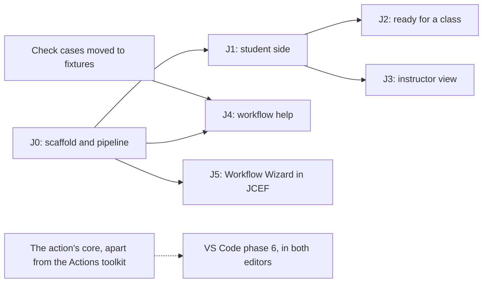

# JetBrains plugin — plan

> **Recorded:** 2026-10-19 (`d1f974c`), against VS Code extension 0.4.4.
> **Updated:** 2026-10-21, J1's reader, GitHub sign-in and the questions tool window.
> **Status:** J0 done, except the first upload, which moved to J1. J1 in
> progress: see [J1 progress](#j1-progress).

A JetBrains plugin that does what GrillMyCode Companion does in VS Code: the
questions the action posts, shown beside the code they ask about. It lives in
`extensions/jetbrains/` and releases on its own `jetbrains-v*` tags.

Elsewhere: the VS Code extension's plan, which this follows, in
`vscode-extension-plan.md`, and the rules for contributors in `AGENTS.md`.

---

## Phases at a glance

| Phase | What it adds                                                                                                                                                                    | Needs first                    | Status                        |
| ----- | ------------------------------------------------------------------------------------------------------------------------------------------------------------------------------- | ------------------------------ | ----------------------------- |
| J0    | Scaffold and pipeline: Gradle IntelliJ Platform Plugin 2.x, Kotlin, ktlint, Plugin Verifier, a CI job on JDK 21, a `jetbrains-v*` release workflow, signing, a devcontainer JDK | Nothing                        | Done, except the first upload |
| J1    | Student side: sign-in, the questions list, the selected question, the jump to code, the moved-code warning, next and previous, several files, the new-questions notice          | J0                             | In progress                   |
| J2    | Ready for a class: the Marketplace listing, a reference page and a line in the student guide, a stable release, hand checks on Windows and macOS                                | J1                             | Not started                   |
| J3    | Instructor view: the answer key beside the student's code, and the view switch                                                                                                  | J1                             | Not started                   |
| J4    | Workflow help: the action's inputs checked, offered and described in a workflow file                                                                                            | J0, and the shared check cases | Not started                   |
| J5    | The docs site's Workflow Wizard in a JCEF tab, reading the open project and writing the workflow file                                                                           | J0                             | Not started                   |

Keep this table current when a phase starts, finishes or changes scope. The
suggested order is J0, J1, J2, then J3 to J5 in any order. VS Code's phase 6
(preview and trial runs) comes to both editors later, from the same extracted
core.

| Phase | Done when                                                                                                                                                     |
| ----- | ------------------------------------------------------------------------------------------------------------------------------------------------------------- |
| J0    | An empty plugin builds, passes the verifier, and the release workflow is ready to sign and publish it                                                         |
| J1    | The fixture tests pass in Kotlin, a student sees their questions in IntelliJ IDEA, PyCharm and WebStorm, and the plugin is on the Marketplace's `eap` channel |
| J2    | A student follows the guide from install to their questions without help                                                                                      |
| J3    | The VS Code phase 3 rules hold, checked against `fixtures/*/with-answers/`, and a student account sees no sign of the instructor view                         |
| J4    | It passes the shared check cases, and sits beside JetBrains' own GitHub Actions support without reporting a problem twice                                     |
| J5    | All ten steps work, dark and light. Where JCEF is missing, the plugin opens the Wizard on the docs site instead                                               |

### J1 progress

| Piece                                                                                         | Where                                                                              | Status                                |
| --------------------------------------------------------------------------------------------- | ---------------------------------------------------------------------------------- | ------------------------------------- |
| Report reader and issue picker, ported with their tests                                       | `shared/Report.kt`, `shared/Issues.kt`                                             | Done, passes every fixture            |
| GitHub sign-in and sign-out, Tools > GrillMyCode                                              | `auth/`                                                                            | Done, tried against GitHub            |
| Owner and repository from the Git remote, the issues listed, the question model               | `shared/Remote.kt`, `shared/GitHub.kt`, `shared/Questions.kt`                      | Done, with the VS Code tests          |
| Tool window: the questions list, a message for each state, open a question's code             | `questions/`, with the bundled Git plugin (`Git4Idea`)                             | Done, tried by hand                   |
| First Marketplace upload, by hand, to the `eap` channel                                       | plugins.jetbrains.com                                                              | Next. JetBrains' review can take days |
| Selected question: a details panel below the tree                                             | A port of `html.js`, shown escaped in `JBHtmlPane`                                 | To do                                 |
| Highlights on the question's lines in the editor                                              | `MarkupModel` range highlighters                                                   | To do                                 |
| Moved-code warning                                                                            | `describeDrift`, with changed files from `ChangeListManager` and unsaved documents | To do                                 |
| Next and previous question                                                                    | Actions on `adjacentQuestion`                                                      | To do                                 |
| Choosing among several questions issues, remembered by title                                  | `chooseIssue`'s `preferredTitle`, kept per project                                 | To do                                 |
| New-questions notice: a check every minute while the IDE has the focus, a balloon and a badge | `whatArrived`                                                                      | To do                                 |
| The untrusted-project message                                                                 | `TrustedProjects`                                                                  | To do                                 |
| Hand checks in PyCharm and WebStorm, then J1 is done                                          |                                                                                    | To do                                 |

---

## The approach: Kotlin, with the contracts shared

A JetBrains plugin runs on the JVM, so `extensions/vscode/src/shared/` cannot
be loaded as it is.

| Option                                         | Verdict                                                                                    |
| ---------------------------------------------- | ------------------------------------------------------------------------------------------ |
| A Kotlin port of `shared/`, tested on fixtures | **Chosen.** Idiomatic, works in every IDE, and the fixtures keep the two readers in step   |
| The JavaScript run in GraalJS                  | A large runtime, hard to debug, and unusual for a Marketplace review                       |
| The JavaScript run on Node                     | Only some IDEs ship Node. Students on PyCharm or IntelliJ IDEA Community would be left out |

Each feature then exists twice. What keeps the two from drifting is test data
both editors read, in a form neither language owns:

| Contract                              | Shared today                              | Needed for JetBrains                                    |
| ------------------------------------- | ----------------------------------------- | ------------------------------------------------------- |
| Report and answer-key layout          | `extensions/fixtures/`, JSON and Markdown | A Kotlin test that reads the same folders               |
| The action's inputs                   | `action-inputs.js`, generated             | The same generator also writes `action-inputs.json`     |
| Input checks                          | Cases inside `test/input-checks.test.js`  | The cases moved to fixtures, so both suites run them    |
| Code matching, the moved-code warning | Cases inside the JavaScript tests         | The same                                                |
| Workflow Wizard                       | `docs-site/docs/_workflow-wizard/`        | Bundled where it stands and shown in JCEF. Never ported |

---

## How the pieces map

| VS Code                                                               | JetBrains                                                                                                                |
| --------------------------------------------------------------------- | ------------------------------------------------------------------------------------------------------------------------ |
| Activity bar view: Questions and Selected Question                    | A tool window: a tree above a details panel                                                                              |
| Selected Question webview, which runs no script                       | A Swing HTML pane (`JBHtmlPane`) with issue text escaped. No JCEF, so the one page that runs a script stays the Wizard's |
| Highlight and jump to code                                            | `MarkupModel` range highlighters and `OpenFileDescriptor`                                                                |
| VS Code's built-in Git extension                                      | The bundled Git plugin (`Git4Idea`), for remotes and HEAD                                                                |
| Restricted Mode                                                       | `TrustedProjects`, with the same message for a project that is not trusted                                               |
| `vscode.authentication`, the `repo` scope                             | Our own GitHub device flow (`auth/`), the token in `PasswordSafe`. See [Decisions](#decisions)                           |
| Welcome views, one per state (`signedOut`, `noIssue`, `needsUpdate`…) | An empty-state panel in the tool window, in the same words                                                               |
| The new-questions notice                                              | A notification balloon and a badge on the tool window's icon                                                             |
| Workflow help                                                         | An inspection, a completion contributor and a documentation provider on the YAML plugin's PSI                            |
| The Workflow Wizard's tab                                             | `JBCefBrowser`, a `JBCefJSQuery` bridge for the Wizard's `host`, and the same content security policy                    |
| The walkthrough                                                       | A short "Get started" panel the first time the tool window opens                                                         |

The VS Code [rules that outlast the phases](vscode-extension-plan.md#rules-that-outlast-the-phases)
apply here too. In particular: the report format, not the version number, ties
the plugin to the action; an unknown input is a warning, never an error; there
is one Workflow Wizard; and a student's copy shows no sign of the instructor
view.

---

## Changes outside `extensions/jetbrains/`

| Where                                      | Change                                                                                                                   | Status    |
| ------------------------------------------ | ------------------------------------------------------------------------------------------------------------------------ | --------- |
| `AGENTS.md`                                | A JetBrains section: Kotlin is allowed in this folder alone, it reads the shared fixtures, its tag prefix, its own rules | Done (J0) |
| `scripts/build-extension-action-inputs.js` | Also writes JSON. `test/extension-action-inputs.test.js` checks that file too                                            | To do     |
| `extensions/fixtures/`                     | New folders for the input-check and code-matching cases, and the JavaScript tests read them from there                   | To do     |
| `extensions/README.md`                     | The plugin's commands and release steps                                                                                  | Done (J0) |
| `docs-site/docs/reference/`                | A JetBrains plugin page, and a line in the student guide once J2 ships                                                   | J2        |
| `release.yml`, `branch-build.yml`          | Check that a `jetbrains-v*` tag cannot release the action                                                                | Done (J0) |
| `.devcontainer/`                           | A JDK                                                                                                                    | Done (J0) |
| `.prettierignore`, `pnpm lint`             | Leave out `extensions/jetbrains/build/`. Kotlin is linted by Gradle                                                      | Done (J0) |
| `extensions/fixtures/README.md`            | Says that a layout change now means a reader in each editor                                                              | Done (J1) |
| `vscode-extension-checks.yml`              | Does not run for changes to the plugin alone                                                                             | Done (J0) |

---

## Decisions

The ID and the oldest IDE are in the code already, but can change until the
first upload; the ID cannot after it.

| Decision               | Options                                                                                                                                                                                               | Outcome                                                                                                                                                                                                                                                                      | Status                       |
| ---------------------- | ----------------------------------------------------------------------------------------------------------------------------------------------------------------------------------------------------- | ---------------------------------------------------------------------------------------------------------------------------------------------------------------------------------------------------------------------------------------------------------------------------- | ---------------------------- |
| How students sign in   | The account in JetBrains' bundled GitHub plugin: often signed in already, but its API is not stable. Or our own GitHub device flow, the token in `PasswordSafe`: stable, needs a registered OAuth app | Our own device flow, with the `repo` scope. A GitHub OAuth app, "GrillMyCode Companion", with device flow on and no client secret. A classroom organization that restricts OAuth apps must approve it once. Its tokens do not expire: refreshing one needs the client secret | Settled (J1), 2026-10-20     |
| Oldest IDE supported   | 2024.3, 2025.1, later                                                                                                                                                                                 | 2025.1 (`pluginSinceBuild = 251`). Check what lab machines run                                                                                                                                                                                                               | Used in J0, until the upload |
| Plugin ID and name     | `org.grillmycode.companion`, "GrillMyCode Companion"                                                                                                                                                  | As listed, the VS Code name                                                                                                                                                                                                                                                  | Used in J0, until the upload |
| Pre-releases           | The Marketplace has channels, not VS Code's odd and even minor numbers                                                                                                                                | A version suffix names the channel: `0.1.0-eap.1` goes to `eap`, `0.2.0` to the default one                                                                                                                                                                                  | Settled (J0)                 |
| The Marketplace vendor | A personal account or an organization's                                                                                                                                                               | The `GrillMyCode` organization, created 2026-10-20                                                                                                                                                                                                                           | Settled (J0)                 |
| Who approves a publish | A pushed tag publishes on its own, or an environment with a reviewer                                                                                                                                  | The `jetbrains-marketplace` environment: secrets released to `jetbrains-v*` tags only, with an optional required reviewer                                                                                                                                                    | Settled (J0)                 |
| When to upload first   | With J0's empty plugin, or with a working slice of J1                                                                                                                                                 | A J1 slice: sign-in and the questions list. JetBrains may reject a plugin that does nothing, and a rejection costs more than waiting                                                                                                                                         | Settled (J0)                 |

---

## Risks

| Risk                                             | What follows                                                                                                         |
| ------------------------------------------------ | -------------------------------------------------------------------------------------------------------------------- |
| Size                                             | Large. J1 alone is about VS Code's phase 1, and J0's toolchain is new to the repository                              |
| Two readers of every report layout               | Each layout change is work in both editors. The shared fixtures are what make it safe                                |
| The first Marketplace upload is reviewed by hand | It can take days, and is done by hand on the site. Upload J1's first working slice well before a term starts         |
| The release workflow is untested end to end      | It cannot publish until the listing exists. Its first run is the version after the manual upload                     |
| JCEF is missing in some setups                   | Remote development and some Linux builds. J5 falls back to the docs site                                             |
| JetBrains' own GitHub Actions support            | It may report the same problems J4 does. Leave to it what it already covers, as phase 5 does with GitHub's extension |
