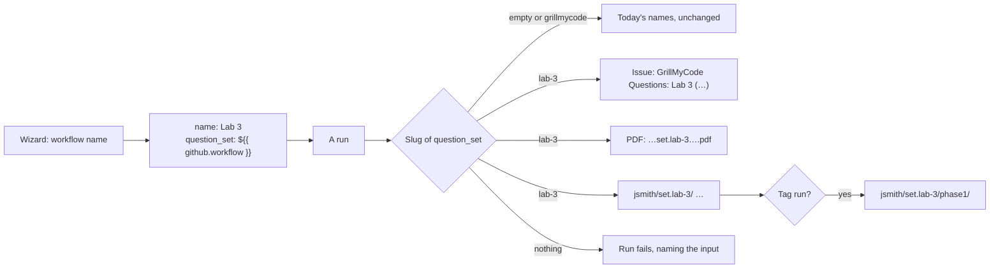
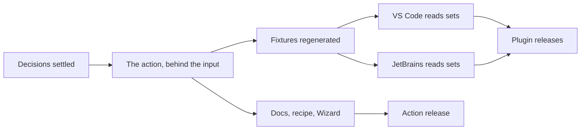

# Question sets — plan

> **Recorded:** 2026-10-23 (`6e8c861`), against action v0 and both editor
> plugins at 0.2.0 (JetBrains) and 0.4.5 (VS Code).
> **Status:** Released 2026-10-23 in action v0.31.0, VS Code 0.6.0 and
> JetBrains 0.3.0. Every decision is settled. Hand checks still to do are in
> [Progress](#progress).

Two workflows in one student repository, both run by hand, write to the same
issue, PDF and instructor-repository folder, and the last to finish wins. Run
at once, they can leave one run's `questions.md` beside the other's
`questions.json`. A submission tag is the only thing that keeps sets apart
today, and a run started from a branch has none.

The Workflow Wizard asks for the workflow's name, **GrillMyCode** by default.
Each name is a set of its own: its own issue, PDF and folder in the instructor
repository. Reusing a name replaces that set, as every run does today. The
default name keeps today's names exactly.

---

## What changes, at a glance

The Wizard writes the name twice: as the workflow's `name:`, and through a new
input, `question_set: ${{ github.workflow }}`, so the action reads it.

| Output                     | Today, and a workflow named GrillMyCode | A workflow named Lab 3                       |
| -------------------------- | --------------------------------------- | -------------------------------------------- |
| Workflow file (Wizard)     | `.github/workflows/grill-my-code.yml`   | `.github/workflows/grill-my-code-lab-3.yml`  |
| Issue title                | `GrillMyCode Questions (main)`          | `GrillMyCode Questions: Lab 3 (main)`        |
| Issue title, tag run       | `GrillMyCode Questions (tag: phase1)`   | `GrillMyCode Questions: Lab 3 (tag: phase1)` |
| Hidden data                | `{"version":1,"headSha":…}`             | the same, with `"set":"lab-3"`               |
| PDF                        | `grill-my-code-<repo>.pdf`              | `grill-my-code-<repo>.set.lab-3.pdf`         |
| PDF, tag run               | `grill-my-code-<repo>-phase1.pdf`       | `grill-my-code-<repo>.set.lab-3-phase1.pdf`  |
| Instructor folder          | `jsmith/`                               | `jsmith/set.lab-3/`                          |
| Instructor folder, tag run | `jsmith/phase1/`                        | `jsmith/set.lab-3/phase1/`                   |
| Answer key                 | `jsmith/data/questions.json`            | `jsmith/set.lab-3/data/questions.json`       |
| Quiz files                 | beside `jsmith/questions.md`            | beside `jsmith/set.lab-3/questions.md`       |

---

## Decisions

| Decision                        | Options                                                                          | Choice or recommendation                                                                                                                                                                                                                                              | Status  |
| ------------------------------- | -------------------------------------------------------------------------------- | --------------------------------------------------------------------------------------------------------------------------------------------------------------------------------------------------------------------------------------------------------------------- | ------- |
| What separates sets             | The workflow's name; a trigger; a free-standing label                            | **The workflow's name**, which the instructor already sees in the Actions tab                                                                                                                                                                                         | Settled |
| Add the trigger to the set      | `<name>-<event>`; the name alone                                                 | **The name alone.** One workflow runs on several triggers: a manual re-run of a failed push run must land on the same answer key, not open a second issue on the branch. Tag runs are already apart, by tag group                                                     | Settled |
| A reused name                   | Replace; refuse                                                                  | **Replace**, as every run does today. Workflow help warns about two files in one repository that share a set (see [The editor plugins](#the-editor-plugins))                                                                                                          | Settled |
| How the action learns the name  | `question_set` defaults to `${{ github.workflow }}`; the Wizard writes the input | **The Wizard writes `question_set: ${{ github.workflow }}`**, in every workflow it makes. A default in `action.yml` would move every workflow not named GrillMyCode on the next `v0` release, mid-term: its history restarts and older plugins stop showing its issue | Settled |
| The default name                | GrillMyCode files as today; GrillMyCode is a set like any other                  | **A slug of `grillmycode` is no set**, exactly as an empty value is. The Wizard's default output then matches every docs workflow and today's plugins                                                                                                                 | Settled |
| The input's name                | `question_set`, `assessment_name`, `delivery_group`                              | `question_set`: says what it separates. Instructors never type it; the Wizard writes it                                                                                                                                                                               | Settled |
| The slug                        | `safeFilePart` as it is; `safeFilePart`, lowercased                              | **Lowercased.** `safeFilePart` keeps case, and a Windows or macOS clone of the instructor repository cannot hold `Lab-3/` beside `lab-3/`. So `Lab 3` and `lab 3` are one set, by design                                                                              | Settled |
| How a set is marked in a folder | `jsmith/lab-3/`; `jsmith/sets/lab-3/`; `jsmith/set.lab-3/`                       | **`set.lab-3`.** A slug never holds a `.`, so it cannot collide with a tag group's folder (`jsmith/lab-3/` would, for a tag pattern `lab-3`) or with `data/` and `history/`. The PDF uses the same mark                                                               | Settled |
| Where the set goes in the title | `GrillMyCode Questions: Lab 3 (main)`; `GrillMyCode Questions (Lab 3, main)`     | **Before the group, after a colon.** Old plugins match `GrillMyCode Questions (` exactly, so they ignore a set's issue rather than misread it. A branch name cannot hold a space, so the group is the last ` (…)`                                                     | Settled |
| The title shows                 | The name as written; the slug                                                    | The name as written, trimmed and capped in length. The plugins read the set from the hidden data, so the title need not be parsed for it                                                                                                                              | Settled |
| A value that slugs to nothing   | Fail the run; fall back to a fixed name                                          | **Fail the run**, naming the input. A fallback would merge two sets that both fail to slug. The Wizard refuses such a name before it gets that far                                                                                                                    | Settled |
| The Wizard's file name          | Always `grill-my-code.yml`; from the name                                        | **From the name**: `grill-my-code.yml` for GrillMyCode, `grill-my-code-<slug>.yml` otherwise. With one fixed file, making a second set in the editor would offer to replace the first                                                                                 | Settled |
| The phase recipe's second file  | Add `question_set`; leave it                                                     | **Add it.** `GrillMyCode phase 2` runs by hand from `main` today file over phase 1's. Its tag runs then move to `jsmith/set.grillmycode-phase-2/phase2/`, which only reaches courses that copy the recipe again                                                       | Settled |
| `ISSUE_LAYOUT_VERSION`          | Raise to 2; keep 1                                                               | **Keep 1.** `set` is an added field, and only an issue with a set has it. Old plugins never read those issues, because of the title                                                                                                                                   | Settled |

---

## Gotchas this has to handle

| Gotcha                                | Where                                                                                     | Handling                                                                                                                               |
| ------------------------------------- | ----------------------------------------------------------------------------------------- | -------------------------------------------------------------------------------------------------------------------------------------- |
| Renaming the workflow moves its set   | `name:` is the set                                                                        | A new folder, issue and PDF from the next run. The reference page and the Wizard's field say so plainly                                |
| A copied file keeps the name          | Copy `grill-my-code.yml`, forget to rename                                                | Both files are one set and replace each other, as today. Workflow help warns                                                           |
| An unnamed workflow                   | `github.workflow` is then the file's path                                                 | Only a hand-edited file. Its set is the path's slug, `github-workflows-<file>-yml`. The reference page says to name the workflow       |
| A hand-written workflow with no input | Every workflow written before this                                                        | No set: today's names. Nothing moves                                                                                                   |
| The student can edit the value        | The workflow is in their repository                                                       | Contained: the set is a folder inside the student's own folder. Validate the slug as `tagGroupSlug` is validated                       |
| Set and tag nest one level deeper     | `src/workflows/generate-lms-quiz.yml` triggers on `*/data/` and `*/*/data/`               | Add `*/*/*/data/questions.json`, and check its own walk of the folders. The action re-syncs this file into every instructor repository |
| The submission log and history        | `readSubmissionHistory`, `submissions.md`, `history/`                                     | Per set and tag group, under the set's folder. Nothing else changes                                                                    |
| Concurrency                           | The examples' `group: grillmycode-${{ github.workflow }}-${{ github.ref }}`               | Already per workflow name, so per set. Separate folders end the mixing                                                                 |
| The instructor repository's README    | `templates/instructor-repo-readme.md`                                                     | Describe the set folders                                                                                                               |
| The editors save to one fixed file    | `WORKFLOW_FILE` in `shared/constants.js` and `Constants.kt`; the Wizard's **Review** step | The page names the file; the host accepts only `grill-my-code.yml` or `grill-my-code-<slug>.yml`, never a path                         |
| The editor plugins choose by title    | `parseIssueTitle`, `chooseIssue`, the answer-key path                                     | See [The editor plugins](#the-editor-plugins)                                                                                          |

---

## The action

| Piece                 | Where                                                   | Change                                                                                                                      |
| --------------------- | ------------------------------------------------------- | --------------------------------------------------------------------------------------------------------------------------- |
| The input             | `action.yml`, `src/inputs.js`, `src/constants.js`       | `question_set`, default empty. Constants: the `set.` mark, the default set's slug `grillmycode`, the title's length cap     |
| Its slug              | `src/context.js`, beside `tagGroupSlug`                 | `questionSetSlug(value)`: `safeFilePart`, lowercased; `''` for empty or `grillmycode`; throws when a value slugs to nothing |
| The issue title       | `postIssue` in `src/delivery/issue.js`                  | `GrillMyCode Questions: <name> (<group>)`. Its exact-title match keeps sets apart                                           |
| The hidden data       | `questionsComment` in `src/report.js`                   | Adds `set` when there is one                                                                                                |
| The PDF name          | `src/main.js`, where `pdfFilename` is built             | Adds `.set.<slug>` before any tag group                                                                                     |
| The instructor folder | `assessmentFolder` in `src/delivery/instructor-repo.js` | `{student}/set.<slug>[/{tagGroup}]`                                                                                         |
| The quiz workflow     | `src/workflows/generate-lms-quiz.yml`                   | The third depth                                                                                                             |
| The run summary       | `src/main.js`                                           | A **Question set** row when one is set                                                                                      |
| Tests                 | `test/`                                                 | Each name above with and without a set; `GrillMyCode` as no set; a set and a tag together; the slug rules                   |

## The editor plugins

Both editors, the same changes, with the same cases (AGENTS.md: the report
format is a contract).

| Piece                               | VS Code                                                            | JetBrains                                          |
| ----------------------------------- | ------------------------------------------------------------------ | -------------------------------------------------- |
| Read `GrillMyCode Questions: … (…)` | `parseIssueTitle` in `shared/issues.js`                            | `parseIssueTitle` in `shared/Issues.kt`            |
| The set from the hidden data        | `shared/report.js`                                                 | `shared/Report.kt`                                 |
| Which issue opens first on a branch | `chooseIssue`: the one with no set, then the most recently updated | The same                                           |
| A set's label in the picker         | **Choose Which Questions to Show…**                                | The same                                           |
| The answer-key path                 | `instructor/answer-key.js`                                         | `instructor/AnswerKey.kt`                          |
| The input in workflow help          | `RULES` and `shared/input-checks.js`                               | `shared/InputChecks.kt`, from `action-inputs.json` |
| Two files, one set                  | `src/workflow/help.js` reads the other workflow files' sets        | `workflow/WorkflowInspection.kt`, the same         |
| The Wizard's file name              | `src/workflow/wizard.js`                                           | `wizard/WizardHost.kt`                             |
| Fixtures                            | `scripts/build-extension-fixtures.js`: a `question-set` case       | Read by both suites                                |

**The two-files check.** A file's set is its `question_set` value, or its
`name:` where the value is `${{ github.workflow }}` (its path when unnamed),
slugged as the action does. Where two files in `.github/workflows/` give one
set, `question_set` (or `uses:` when the step has none) gets a warning naming
the other files. It does not look at triggers: two tag-only workflows with
different tags warn too, since a manual run of either from `main` collides.
`checkWorkflow` takes the other files' sets as `otherWorkflows`, so the check
stays in `shared/` and its cases are shared.

An older plugin keeps working: it shows the set-less issue and ignores the
others. Each plugin's CHANGELOG says which version reads sets.

## Docs and the Wizard

| Piece                                           | Change                                                                                                                                                                          |
| ----------------------------------------------- | ------------------------------------------------------------------------------------------------------------------------------------------------------------------------------- |
| Workflow Wizard, **Assignment** step            | A **Workflow name** field, GrillMyCode by default. Says that each name is its own set and that reusing one replaces it. Refuses a name with no letter or digit, or one too long |
| Workflow Wizard, `generateYaml.js`              | `name:` from the field, in place of the fixed `name: GrillMyCode`; `question_set: ${{ github.workflow }}` always; `DEFAULTS`                                                    |
| Workflow Wizard, **Review** step                | The file name from the workflow name, in each place it now says `grill-my-code.yml`                                                                                             |
| Workflow Wizard, `host` prop                    | `saveWorkflow` is given the file name. Documented in the Wizard's `index.js`                                                                                                    |
| `.github/prompts/plan-workflowWizard.prompt.md` | The field and the file name                                                                                                                                                     |
| `reference/inputs-outputs.md`, `README.md`      | The input's row                                                                                                                                                                 |
| `reference/assessment-output.md`                | The title and PDF name with a set                                                                                                                                               |
| `reference/instructor-repository.md`            | The folder layout with a set; renaming a workflow; an unnamed workflow                                                                                                          |
| `example-workflows/all-inputs.md`               | `question_set: ${{ github.workflow }}`, with its comment                                                                                                                        |
| A new recipe, `11-question-sets.md`             | Two workflows run by hand, each named for its set                                                                                                                               |
| `example-workflows/4-phase-workflows.md`        | `question_set` in the second file, if settled so                                                                                                                                |
| `guides/running-manually.md`                    | One line: give each workflow its own name to keep its questions apart                                                                                                           |
| The plugins' reference pages                    | Which set opens first, the picker, the two-files warning, the Wizard's file name                                                                                                |
| `scripts/build-extension-action-inputs.js`      | `RULES` entry if the value gets a check of its own                                                                                                                              |

---

## Order

The action can ship first: without the input nothing moves, and with it an
older plugin shows only the set-less issue. Release the Wizard change with the
action, since it is the docs site's, and the plugins soon after, so the
instructor view finds a set's answer key and the editors save each set to its
own file.

| Phase | Done when                                                                                                                                              |
| ----- | ------------------------------------------------------------------------------------------------------------------------------------------------------ |
| 1     | Two Wizard workflows named GrillMyCode and Lab 3, run by hand on `main`, leave two issues, two PDFs and two folders, and the first's names are today's |
| 2     | Both plugins list both sets, open the set-less one first, find each set's answer key, save each set's file, and warn about two files that share a set  |
| 3     | A workflow with a set and submission tags files under `jsmith/set.<slug>/<tag group>/`, and its quiz builds                                            |

## Progress

| Piece                                            | State                                                                    |
| ------------------------------------------------ | ------------------------------------------------------------------------ |
| Action: input, slug, title, data, PDF, folder    | Built, `test/question-set.test.js`                                       |
| Quiz workflow: third depth, title without `set.` | Built; not run against a real instructor repository                      |
| Fixtures: `question-set`, `question-set-tag`     | Built                                                                    |
| Wizard: name field, `question_set`, file name    | Built, `test/wizard-question-set.test.js`; not seen in a browser         |
| VS Code: readers, picker, key path, checks, save | Built, `pnpm test:host` passes                                           |
| JetBrains: the same                              | Built, `./gradlew check` and `buildPlugin`; not tried in an IDE          |
| Docs, recipe 11, phase recipe, CHANGELOGs        | Built, docs build passes                                                 |
| Hand checks                                      | Two workflows run by hand on `main`; a set with a tag; both editors open |
